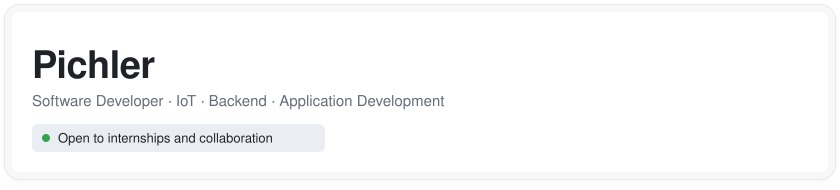
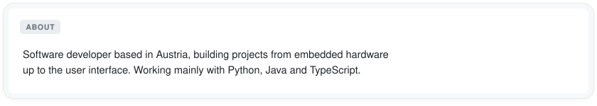
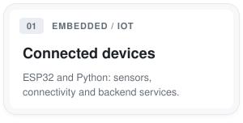
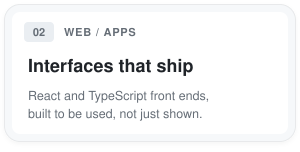
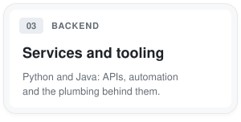
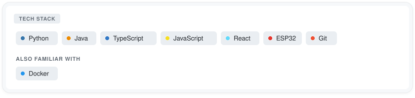

<picture>
    <source media="(prefers-color-scheme: dark)" srcset="assets/card-header-dark.svg">
    
  </picture>

<picture>
    <source media="(prefers-color-scheme: dark)" srcset="assets/card-about-dark.svg">
    
  </picture>

<picture>
    <source media="(prefers-color-scheme: dark)" srcset="assets/card-iot-dark.svg">
    
  </picture>
<picture>
    <source media="(prefers-color-scheme: dark)" srcset="assets/card-web-dark.svg">
    
  </picture>
<picture>
    <source media="(prefers-color-scheme: dark)" srcset="assets/card-backend-dark.svg">
    
  </picture>

<picture>
    <source media="(prefers-color-scheme: dark)" srcset="assets/card-stack-dark.svg">
    
  </picture>

 

